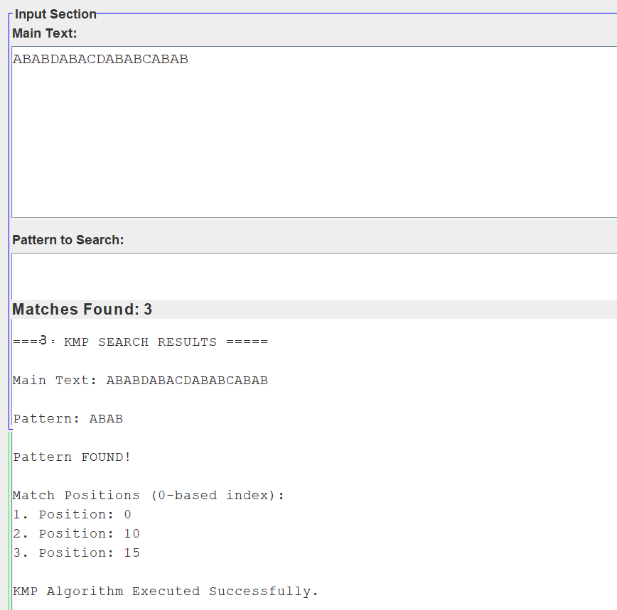

# KMP Pattern Matching Algorithm Using Java

## Project Overview

This project is based on the **Knuth-Morris-Pratt (KMP) Pattern Matching Algorithm**, implemented using Java programming language and Java Swing GUI.

The main purpose of this project is to search for a specific pattern within a given text efficiently using the KMP algorithm.

This is the **60% Progress Version** of the project. The basic graphical user interface, LPS calculation, pattern searching, match counting, and match position detection have been implemented.

## Technologies Used

- Java
- Java Swing
- Visual Studio Code (VS Code)
- JDK

## Implemented Features (60%)

The following features have been completed:

1. Designed a graphical user interface using Java Swing.
2. Created a Main Text input section.
3. Created a Pattern to Search input field.
4. Added a Search button.
5. Added a Clear All button.
6. Implemented the LPS (Longest Prefix Suffix) array calculation.
7. Implemented the KMP Pattern Matching Algorithm.
8. Implemented pattern searching functionality.
9. Displayed the total number of matches.
10. Displayed the positions of matched patterns.
11. Added basic input validation.
12. Displayed search results in the GUI.

## Project Structure

```text
KMP_Project/
│
└── src/
    └── kmp/
        └── project/
            └── KMPMatcherGUI.java
```

## How to Run the Project

### Step 1: Install Requirements

- Install Java JDK.
- Install Visual Studio Code.
- Install the Extension Pack for Java in VS Code.

### Step 2: Open Project

Open the project folder in Visual Studio Code.

### Step 3: Compile the Program

Open the VS Code terminal and execute:

```bash
javac -d out src/kmp/project/KMPMatcherGUI.java
```

### Step 4: Run the Program

Execute the following command:

```bash
java -cp out kmp.project.KMPMatcherGUI
```

The Java Swing GUI application will open in a separate window.

## Sample Input

**Main Text:**

```text
ABABDABACDABABCABAB
```

**Pattern to Search:**

```text
ABAB
```

## Expected Output




### Output Explanation

- Total Matches Found: 3
- Pattern: ABAB
- First Match Position: 0
- Second Match Position: 10
- Third Match Position: 15

The pattern `ABAB` is found three times in the given main text.

## KMP Algorithm

The Knuth-Morris-Pratt algorithm is an efficient string-searching algorithm.

It uses an LPS (Longest Prefix Suffix) array to avoid unnecessary character comparisons during pattern searching.

Instead of checking the same characters repeatedly, the KMP algorithm uses previously matched information to continue searching efficiently.

### Time Complexity

- LPS Array Calculation: O(m)
- Pattern Searching: O(n)
- Overall Time Complexity: O(n + m)

Where:

- n = Length of the main text.
- m = Length of the search pattern.

## Current Project Progress

### Completed (60%)

- [x] Java Swing GUI Design
- [x] Main Text Input
- [x] Pattern Input
- [x] Search Button
- [x] Clear All Button
- [x] LPS Array Calculation
- [x] KMP Searching Algorithm
- [x] Match Count Display
- [x] Match Position Detection
- [x] Basic Search Result Display

### Remaining Work (40%)

- [ ] Highlight matching patterns in the original text.
- [ ] Calculate match percentage.
- [ ] Display detailed search statistics.
- [ ] Display algorithm performance information in the GUI.
- [ ] Improve GUI design.
- [ ] Complete final testing and debugging.

## Project Status

**Current Progress: 60% Completed**

The basic GUI and core KMP searching functionality have been implemented successfully. The remaining features will be added in the next development phase.

## Conclusion

This project demonstrates how the KMP Pattern Matching Algorithm works using a Java Swing graphical interface.

The current version successfully accepts text and a search pattern, finds matching occurrences, and displays their positions.

Further improvements will be implemented to complete the remaining 40% of the project.

---

**Project:** KMP Pattern Matching Algorithm

**Language:** Java

**Progress:** 60% Completed
